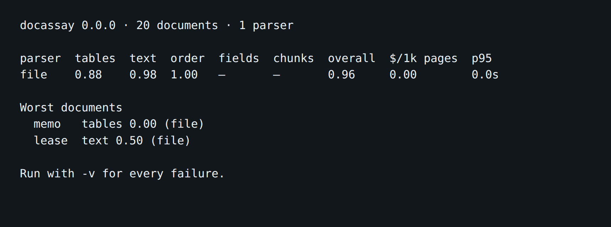

# docassay

**pytest for document ingestion.** Score any document parser against your own labeled documents, catch regressions in CI, and verify that extracted values match their sources.

> Status: pre-alpha. Nothing is published to PyPI or npm yet. The commands below are the quickstart those packages will run, and the scorecard is from this repository's `golden/` set.

## 60-second quickstart

Python (3.10+):

```bash title="python/tests/docs_snippets/install-pip.txt"
pip install docassay
```

Node (18+):

```bash title="python/tests/docs_snippets/install-npm.txt"
npm install docassay
```

From an empty directory, `docassay init` writes a config and one golden file. The script below fills in the sentence that file labels, adds a readable source file, and prints a scorecard:

```bash title="python/tests/docs_snippets/quickstart.sh"
set -euo pipefail
docassay init
mkdir -p golden/files out/parsed
printf '%s\n' 'Replace this with a sentence from the document' > out/parsed/example.md
printf '%s\n' '%PDF-1.1' > golden/files/example.pdf
docassay run
```

The public example in [`golden/`](golden/) scores 20 documents with the `file` adapter:



## Why

Teams pick a PDF parser by eyeballing a few files, then ship and hope. When a vendor updates a model or someone tweaks a chunker, tables quietly turn into digit soup and retrieval gets worse with no error. docassay makes ingestion quality measurable and testable:

1. **Label** 10–30 of your own documents in YAML (drafted for you by `docassay label`).
2. **Run** any parser through an adapter and get a scorecard.
3. **Baseline** today's scores and **check** them on every pull request.
4. **Verify** extracted values against their cited source spans in production.

docassay never parses documents itself. It judges the parsers you already use.

## Docs

Published site: <https://andrewx24.github.io/Docassay/>.

- [Quickstart](docs/docs/guides/quickstart.mdx)
- [Writing golden files](docs/docs/guides/golden-files.mdx)
- [Metrics explained](docs/docs/guides/metrics.mdx)
- [How we score](docs/docs/guides/how-we-score.mdx)
- [CI setup](docs/docs/guides/ci.mdx)
- [Writing an adapter](docs/docs/guides/adapter.mdx)
- [Architecture](docs/docs/architecture/overview.md)
- [Build plan](docs/docs/implementation/build-plan.md)
- [Agent guide](AGENTS.md) for coding agents

Run the docs site locally with `cd docs && npm install && npm start`.

## Repository

| Folder | Contents |
| --- | --- |
| `spec/` | JSON Schemas shared by both packages, plus parity fixtures |
| `python/` | PyPI package (Poetry) |
| `js/` | npm package (TypeScript) |
| `golden/` | Public example golden set |
| `action/` | GitHub Action that runs `docassay check` and comments on the pull request |
| `examples/workflows/` | Pull request and nightly drift workflow examples |
| `docs/` | Docusaurus documentation site |

## License

Apache-2.0
