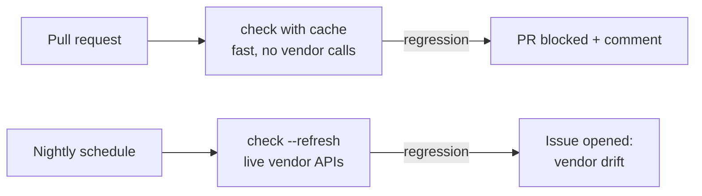

# CI gate

The gate is what turns a one-off benchmark into a test that keeps ingestion good. Built in **ALI-327** (logic) and **ALI-328** (GitHub Action).

## Baseline

`docassay baseline` runs the suite and writes `.docassay/baseline.json` (format: [Baseline](spec.md#baseline)). The file is committed, so every pull request that changes it shows the score change in its diff.

## Check algorithm

`docassay check` runs the suite, then compares the new scorecard `C` to the baseline `B`:

```text
for each parser p in C:
  if p not in B: warn "new parser, no baseline"; continue
  for each metric m in C[p].summary:
    t = thresholds[m] or thresholds.default
    if C[p].summary[m] < B[p].summary[m] - t.drop: FAIL (summary regression)
    if t.min is set and C[p].summary[m] < t.min:     FAIL (below floor)
  for each document d in C[p].documents:
    if d not in B[p]: warn "new document"; continue
    if d.error and not B[p][d].error:                FAIL (document now errors)
    for each metric m in d.scores:
      if d.scores[m] < B[p][d].scores[m] - t.drop:   FAIL (document regression)
for each parser or document in B missing from C: warn
exit 1 if any FAIL else 0
```

Score **improvements never fail**. The output suggests running `docassay baseline` to lock them in.

Flags: `--summary-only` (skip per-document checks), `--baseline <path>`.

## Failure output

```text
FAIL  reducto · invoice-acme · tables 1.0000 → 0.8500 (−0.1500, allowed −0.0100)
      tables[0].cells[1]: expected "1,200.00", got "1,200.00 Tax"
FAIL  docling · summary · order 0.9200 → 0.8800 (−0.0400, allowed −0.0200)

2 regressions · 0 warnings · run `docassay baseline` after an intended change
```

## Where checks run



- **On pull requests:** use the committed cache so no vendor calls or secrets are needed. This catches changes in the user's own code (config, chunker, adapter options).
- **Nightly:** `--refresh` calls the live vendors. This catches vendor-side drift, such as a silent model update. The workflow opens an issue instead of blocking anyone.

## GitHub Action (`ALI-328`)

```yaml
- uses: Andrewx24/Docassay/action@v0
  with:
    command: check            # or run
    python-or-node: python    # which package to install
    comment: true             # post/update the Markdown scorecard on the PR
```

The action posts one comment and edits it on later pushes, identified by a hidden marker `<!-- docassay-report -->`.
