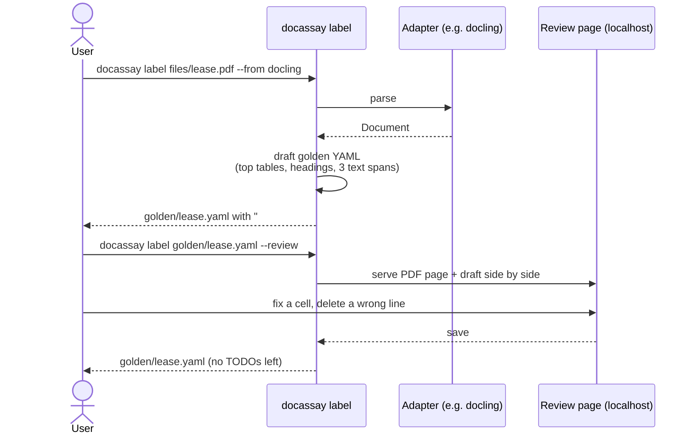

# Golden sets

A golden set is a folder of YAML files, one per source document, that records what correct output looks like. It is the only thing a user has to write, so it must be **small, partial and quick to produce**.

## Principles

- **Partial labels are normal.** Label the three cells that matter, not the whole table. Every section is optional.
- **10–30 documents is enough.** Pick documents that represent your traffic and the ones that have hurt you before.
- **Labels describe content, not a parser's format.** Write `"1,200.00"` as it appears on the page; normalization handles `1200`, `$1,200.00` and `1 200,00`.
- **Golden files live in the user's repo**, next to their code, and change through pull requests like tests.

## Section semantics

| Section | Meaning | Scored by |
| --- | --- | --- |
| `tables[]` | A table on `page` with this `header`, about `rows` body rows, and these `cells` | [Tables](scoring.md#tables) |
| `text_contains[]` | Each string must appear in the full document text | [Text](scoring.md#text) |
| `reading_order[]` | Each `[a, b]` pair: `a` appears before `b` | [Order](scoring.md#reading-order) |
| `fields{}` | Each key must be extracted with this value | [Fields](scoring.md#fields) |
| `chunks{}` | Rules every chunk must follow | [Chunks](scoring.md#chunks) |

### Choosing good labels

- `text_contains`: pick a sentence that would be lost or garbled by a bad parse, such as text near a column break, a footnote or a scanned region.
- `reading_order`: pick pairs that straddle columns or page breaks. A pair inside one paragraph tests nothing.
- `tables`: always include at least one numeric cell from the middle of the table. Edges are rarely what breaks.

## The labeling flow (`docassay label`)

Labeling friction is the main adoption risk, so the tool drafts labels and the user corrects them.

The draft is produced from a parser, so it inherits that parser's mistakes. That is acceptable only because a human reviews it; `docassay validate --strict` refuses files that still contain `# TODO verify`.

## Draft rules

The same Document, file path, and id produce the same YAML in both languages.

- **Tables.** Keep up to three tables with the largest size. Size is the header length plus the lengths of the body rows. Size zero is skipped. Equal sizes keep the earlier table. Each table records `page`, `header` when the parser found one, `rows` (body-row count), `cols` (the longer of the header and the longest body row), and up to two cells on the middle body row (`row count // 2`). Those columns are the ones nearest the center `(width - 1) / 2`. A tie keeps the lower index, and the cells are written in column order. The column label is the header cell when that text is non-empty and unique; otherwise it is the column index.
- **text_contains.** Up to three snippets, in this order, skipping duplicates: the last non-empty snippet on the second-to-last page that has text, when the document has two or more such pages; the first footnote or caption in reading order; the last non-empty snippet on the last page that has text. A snippet is trimmed with the explicit whitespace set from [Normalization](normalization.md). Longer than 80 characters, it is cut back to the last whitespace at or before 80, or hard-cut at 80 when there is no whitespace.
- **reading_order.** Up to two pairs of different strings. With two or more pages, the first pair is the last text on the first page and the first text on the next page. With three or more pages, the next pair is the last text on the second-to-last page and the first text on the last page. If fewer than two pairs were chosen, the first block and the last block are used. On a single page, the pairs are first-to-last and first-to-middle (`count // 2`).
- **fields.** Copy parser fields in insertion order, value only. Integral numbers are written as integers. Strings are JSON-quoted. A field key stays bare only when it matches `[A-Za-z][A-Za-z0-9_]*`; every other key is quoted.
- **Comments.** Every drafted value ends with ` # TODO verify`. The `file` and `id` lines do not. Empty sections are omitted. Saving from the review page rewrites the file with the same renderer and drops the comments.
- **Review page.** `docassay label <golden.yaml> --review` binds to `127.0.0.1` and shows the source file in an iframe loaded from `/source` on that same origin. The page does not load a CDN. Saving writes the golden file and stops the server.

## Validation

`docassay validate` checks every golden file against `golden.schema.json` and also checks:

- `file` exists and is readable.
- `cells[].col` names exist in `header`.
- `reading_order` pairs have two different, non-empty strings.
- No duplicate `id` across the set.

Errors report the YAML file, line and column.
