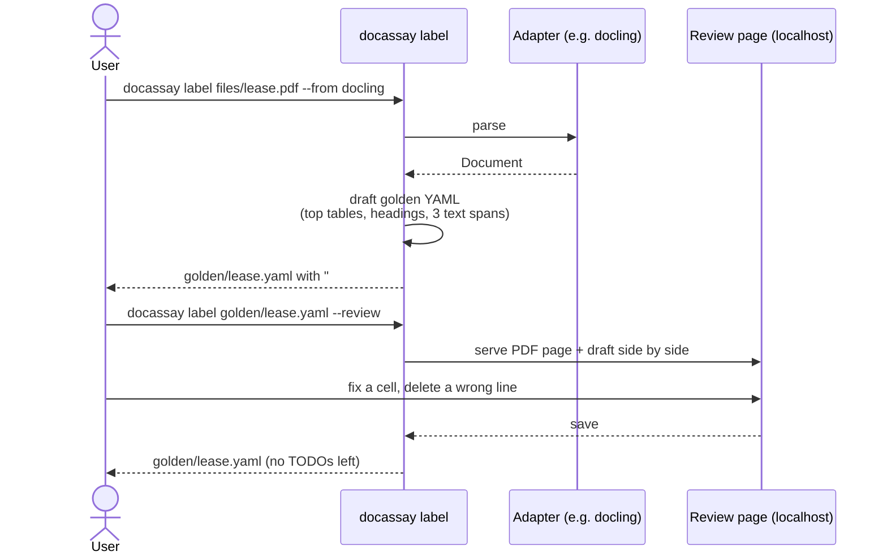

# Golden sets

A golden set is a folder of YAML files, one per source document, that records what correct output looks like. It is the only thing a user has to write, so it must be **small, partial and quick to produce**.

## Principles

- **Partial labels are normal.** Label the three cells that matter, not the whole table. Every section is optional.
- **10–30 documents is enough.** Pick documents that represent your traffic and the ones that have hurt you before.
- **Labels describe content, not a parser's format.** Write `"1,200.00"` as it appears on the page; normalization handles `1200`, `$1,200.00` and `1 200,00`.
- **Golden files live in the user's repo**, next to their code, and change through pull requests like tests.

## Section semantics

| Section | Meaning | Scored by |
| --- | --- | --- |
| `tables[]` | A table on `page` with this `header`, about `rows` body rows, and these `cells` | [Tables](scoring.md#tables) |
| `text_contains[]` | Each string must appear in the full document text | [Text](scoring.md#text) |
| `reading_order[]` | Each `[a, b]` pair: `a` appears before `b` | [Order](scoring.md#reading-order) |
| `fields{}` | Each key must be extracted with this value | [Fields](scoring.md#fields) |
| `chunks{}` | Rules every chunk must follow | [Chunks](scoring.md#chunks) |

### Choosing good labels

- `text_contains`: pick a sentence that would be lost or garbled by a bad parse, such as text near a column break, a footnote or a scanned region.
- `reading_order`: pick pairs that straddle columns or page breaks. A pair inside one paragraph tests nothing.
- `tables`: always include at least one numeric cell from the middle of the table. Edges are rarely what breaks.

## The labeling flow (`docassay label`)

Labeling friction is the main adoption risk, so the tool drafts labels and the user corrects them.

The draft is produced from a parser, so it inherits that parser's mistakes. That is acceptable only because a human reviews it; `docassay validate --strict` refuses files that still contain `# TODO verify`.

## Validation

`docassay validate` checks every golden file against `golden.schema.json` and also checks:

- `file` exists and is readable.
- `cells[].col` names exist in `header`.
- `reading_order` pairs have two different, non-empty strings.
- No duplicate `id` across the set.

Errors report the YAML file, line and column.
