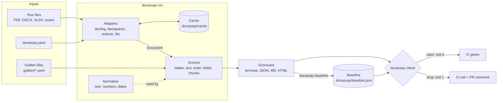

# Architecture overview

docassay is a pipeline with one rule: **every parser's output is converted into one shared `Document` model before anything is scored.** That rule is what makes scores comparable across vendors and identical across the two languages.

## Components

| Component | Responsibility | Doc |
| --- | --- | --- |
| **Spec** | JSON Schemas for `Document`, golden files, config, scorecard and baseline. The source of truth for both languages. | [Spec](spec.md) |
| **Golden sets** | User-written YAML that says what "correct" looks like for each file. | [Golden sets](golden-sets.md) |
| **Adapters** | Call a parser and convert its output into a `Document`. One per parser. | [Adapters](adapters.md) |
| **Normalization** | Deterministic text, number and date canonicalization used by every comparison. | [Normalization](normalization.md) |
| **Scorers** | Pure functions: `(Document, GoldenFile) → MetricResult`. | [Scoring](scoring.md) |
| **Reporters** | Turn results into terminal tables, JSON, Markdown and HTML. | [CLI](cli.md) |
| **Gate** | Compares a scorecard to a baseline and decides pass or fail. | [CI gate](ci-gate.md) |
| **Verify** | Runtime check that an extracted value appears in its cited span. | [Verify](verify.md) |

## Design principles

1. **Judge, don't parse.** docassay never competes with the tools it measures. See [ADR 0004](../adr/0004-judge-not-parse.md).
2. **Spec first.** A field exists in the schema before it exists in code, and both languages generate their types from it. See [ADR 0002](../adr/0002-spec-first.md).
3. **Scorers are pure and deterministic.** No network, no randomness, no clock. Same input, same score, in both languages, every time.
4. **Every score explains itself.** A score below 1.0 always comes with a list of failures: what was expected, what was found, where.
5. **Works offline.** Everything except vendor adapters runs with no API key. The `file` adapter lets anyone score their own pipeline output.
6. **Small core, optional adapters.** Adapters are extras (`docassay[docling]`) or optional peer dependencies, so the core installs in seconds.

## Data flow for one run

1. Load and validate `docassay.yaml` and every `golden/*.yaml`.
2. For each parser × each golden file: look up the cache by file hash, parser id and parser version. On a miss, call the adapter and store the `Document`.
3. Run each scorer whose section is present in the golden file.
4. Aggregate per document, then per parser.
5. Emit the scorecard. `check` additionally compares it to the baseline.

## What is deliberately out of scope for v0.1

- Writing parsers, OCR or chunkers.
- A hosted dashboard or account system.
- Learned or LLM-judged metrics. Every v0.1 metric is a deterministic rule, so it can be explained and reproduced.
- TEDS tree-edit-distance for tables. The v0.1 table metric is header, shape and cell based; TEDS is planned for v0.2.
