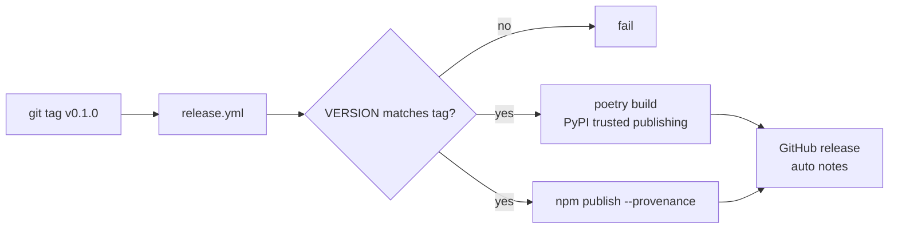

# Packaging and releases

## Python (PyPI, Poetry)

```toml
[tool.poetry]
name = "docassay"
version = "0.0.0"                # set from /VERSION by scripts/sync-version.sh
packages = [{ include = "docassay", from = "src" }]

[tool.poetry.dependencies]
python = ">=3.10"
pydantic = "^2.8"
pyyaml = "^6.0"
jsonschema = "^4.23"
typer = "^0.12"
rich = "^13.7"
httpx = "^0.27"

docling = { version = "*", optional = true }
tiktoken = { version = "*", optional = true }

[tool.poetry.extras]
docling = ["docling"]
tiktoken = ["tiktoken"]
all = ["docling", "tiktoken"]

[tool.poetry.scripts]
docassay = "docassay.cli:app"
```

LlamaParse and Reducto adapters use `httpx` against the REST APIs directly, so they need no extra. If a vendor SDK is clearly better, add it as an extra named after the vendor. Version ranges above are a starting point; pin to current releases when scaffolding.

Tooling: `ruff` (lint + format), `mypy --strict`, `pytest`, `pytest-cov`.

## TypeScript (npm)

```json
{
  "name": "docassay",
  "type": "module",
  "engines": {"node": ">=18"},
  "bin": {"docassay": "./dist/cli.js"},
  "exports": {
    ".":        {"import": "./dist/index.js",  "require": "./dist/index.cjs",  "types": "./dist/index.d.ts"},
    "./verify": {"import": "./dist/verify.js", "require": "./dist/verify.cjs", "types": "./dist/verify.d.ts"}
  },
  "dependencies": {"ajv": "^8", "commander": "^12", "yaml": "^2", "picocolors": "^1"},
  "peerDependencies": {"tiktoken": "*"},
  "peerDependenciesMeta": {"tiktoken": {"optional": true}}
}
```

Built with `tsup` (ESM + CJS + `.d.ts`). Tooling: `eslint`, `tsc --strict`, `vitest`. Use **npm** (no pnpm or yarn) to keep contributor setup to one tool.

## Versioning

- One version for both packages, stored in `/VERSION`.
- `scripts/sync-version.sh` writes it into `pyproject.toml` and `package.json`; CI fails if they disagree.
- The spec has its own semver (`specVersion`); each release notes which spec version it implements.
- Pre-1.0: minor versions may change behavior; patch versions may not change any score.

## Release (ALI-333)



Both registries publish from the same commit. No long-lived tokens: PyPI uses trusted publishing (OIDC) and npm uses provenance with an automation token stored as a repository secret until npm OIDC is configured.
