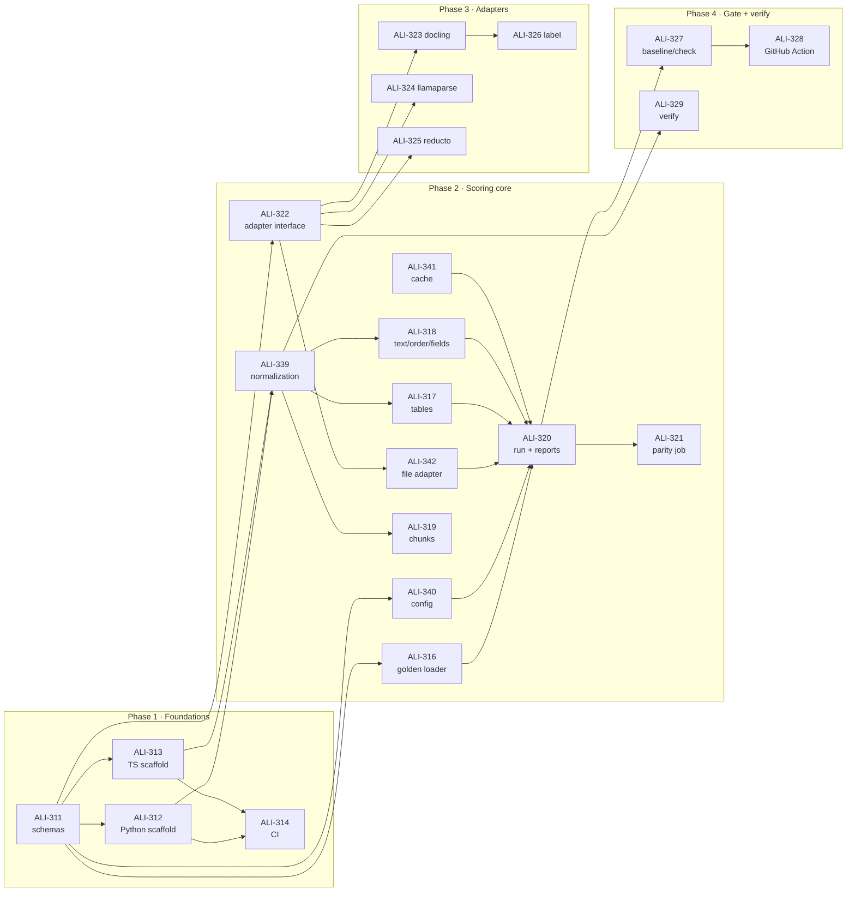

# Build plan

The steps below are in build order. Each step is one Linear issue in the [docassay project](https://linear.app/aliaj/project/docassay-6258bc4cc232), small enough for one pull request. A coding agent (Grok Build) should take the **lowest-numbered step whose blockers are done**.

## Phase 0 · Owner tasks (not for the agent)

| Step | Issue | Task |
| --- | --- | --- |
| 0a | ALI-310 | Reserve `docassay` on PyPI and npm with 0.0.1 placeholders |
| 0b | ALI-330 | Developer interviews, in parallel with phases 1–3 |
| 0c | ALI-337 | Architecture docs and `AGENTS.md` (this site) — done |

## Phase 1 · Foundations (M1, target Nov 9)

| Step | Issue | Deliverable | Blocked by |
| --- | --- | --- | --- |
| 1 | ALI-309 | Branch protection on `main`; folder READMEs already exist | — |
| 2 | ALI-315 | CONTRIBUTING, CODE_OF_CONDUCT, SECURITY, issue/PR templates | — |
| 3 | ALI-311 | Five schemas in `spec/` + examples + `scripts/gen-types.sh` | — |
| 4 | ALI-312 | Poetry package, generated models, `docassay --version` works | 3 |
| 5 | ALI-313 | npm package, generated types, `npx docassay --version` works | 3 |
| 6 | ALI-314 | `ci.yml`: lint, typecheck, test, spec drift on both | 4, 5 |
| 7 | ALI-338 | `docs.yml`: build docs on PR, deploy to GitHub Pages on `main` | — |

## Phase 2 · Scoring core (M2, target Nov 30)

| Step | Issue | Deliverable | Blocked by |
| --- | --- | --- | --- |
| 8 | ALI-339 | `normalize/` in both languages + fixtures in `spec/fixtures/normalize/` | 4, 5 |
| 9 | ALI-316 | Golden loader (YAML 1.2), `docassay validate` | 3, 4, 5 |
| 10 | ALI-340 | Config loader, `docassay init` | 3, 4, 5 |
| 11 | ALI-322 | Adapter protocol, registry, runner skeleton | 3, 4, 5 |
| 12 | ALI-342 | `file` adapter (JSON + Markdown) | 11 |
| 13 | ALI-317 | Table scorer + fixtures | 8 |
| 14 | ALI-318 | Text, reading-order and field scorers + fixtures | 8 |
| 15 | ALI-319 | Chunk scorer + fixtures | 8 |
| 16 | ALI-341 | Parser output cache | 11 |
| 17 | ALI-320 | `docassay run`, aggregation, terminal/JSON/MD/HTML reports | 9, 10, 12, 13, 14, 16 |
| 18 | ALI-321 | `scripts/parity.sh` + CI parity job across all fixtures | 17 |

**Milestone check:** `docassay run` on `golden/` with the `file` adapter prints the same JSON from `pip` and `npm` installs.

## Phase 3 · Adapters (M3, target Dec 14)

| Step | Issue | Deliverable | Blocked by |
| --- | --- | --- | --- |
| 19 | ALI-323 | Docling adapter | 11 |
| 20 | ALI-324 | LlamaParse adapter, all tiers | 11 |
| 21 | ALI-325 | Reducto adapter (parse + extract) | 11 |
| 22 | ALI-326 | `docassay label` draft + review page | 17, 19 |

Steps 19–21 can run in parallel.

## Phase 4 · Gate and verify (M4, target Jan 11)

| Step | Issue | Deliverable | Blocked by |
| --- | --- | --- | --- |
| 23 | ALI-327 | `docassay baseline` and `docassay check` | 17 |
| 24 | ALI-328 | GitHub Action with PR comment | 23 |
| 25 | ALI-329 | `verify()` + `docassay/verify` subpath | 8 |

Step 25 can start as soon as step 8 is merged.

## Phase 5 · Launch (M5, target Jan 25)

| Step | Issue | Deliverable | Blocked by |
| --- | --- | --- | --- |
| 26 | ALI-331 | Public 20-document golden set + first scorecard | 19–21 |
| 27 | ALI-332 | README quickstart, docs polish | 17 |
| 28 | ALI-333 | `release.yml`, ship v0.1.0 | 6 |
| 29 | ALI-334 | Launch posts (owner) | 26–28, 0b |
